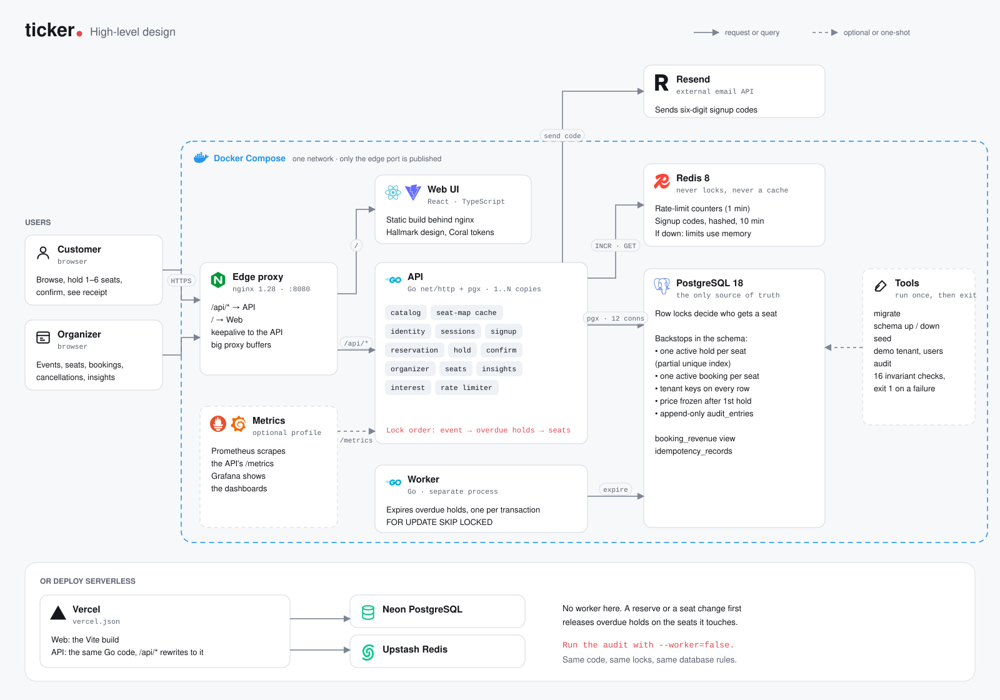
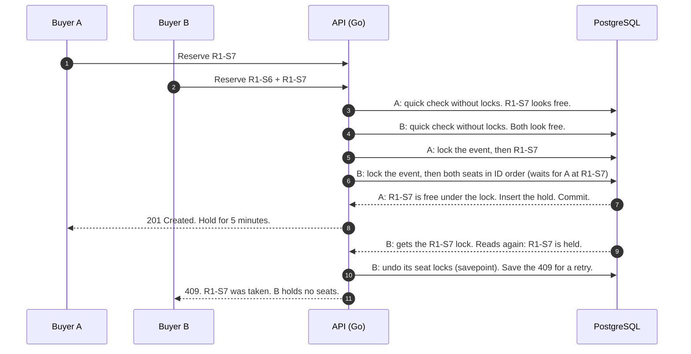

# Ticker

[](https://github.com/Ayan-sh03/ticker/actions/workflows/ci.yml)

Ticker is a seat reservation system for events. You pick up to six seats, hold them for five minutes, and confirm a booking. Organizers make events, block seats, see who booked, cancel bookings, and read sales numbers.

The main goal is simple: **a seat is never sold twice**, even when many people click at the same time. A hold gets all of its seats or none. And you can check every rule after the fact.

<p align="center">
  <a href="docs/media/ticker-demo.mp4">
    
  </a>
  <br>
  <sub>Two customers race for seat R1-S7. One wins, and the other sees which seat was taken. <a href="docs/media/ticker-demo.mp4"><b>Watch the full demo (98 s)</b></a></sub>
</p>

## What it does

**Customers**
- See published events and live seat availability.
- Sign up with a six-digit code from email, or log in.
- Hold 1–6 seats for 5 minutes. If someone takes a seat first, the page names that seat and keeps the others selected.
- Confirm the hold to get a booking and a receipt. Or cancel the hold.
- Cancel your confirmed booking from its receipt before the event starts. Its seats go back on sale.
- Mark an event as "interested".

**Organizers** (each in their own workspace)
- Make private drafts, edit them, and publish them. Delete an event only if nobody ever reserved a seat in it.
- Block or unblock up to 200 seats in one change. The change applies to all of the seats or to none.
- Page through bookings and holds (open, expired, cancelled) with live counts.
- Cancel a confirmed booking before the event starts. Its seats go back on sale.
- Read insights: revenue after the platform fee (5% by default), how many seats sold, a funnel from interest to bookings, revenue by day, and the busiest hours.

## How it is built

<picture>
  <source media="(prefers-color-scheme: dark)" srcset="docs/media/architecture-dark.svg">
  
</picture>

- **Go** (`net/http` and `pgx`) runs the API and the worker. They are two processes from one Go module.
- **PostgreSQL** keeps all of the state. Row locks, taken in one fixed order, decide who gets a seat. Constraints and partial unique indexes are a second line of defense.
- **Redis** keeps only rate-limit counters and short-lived signup codes. If Redis stops, rate limits use memory, and signup returns 503 until Redis is back. Seats and bookings do not use Redis.
- **React + TypeScript + Vite** make the UI. The seat map reuses unchanged rendering work during countdown updates. Reservation and receipt polling keep the same two-second interval and verify the expected account on each protected read.
- **Docker frontend delivery** serves precompressed JavaScript/CSS and caches content-hashed assets. HTML revalidates so a new deployment is discovered.
- An append-only **audit trail** records each hold, confirmation, expiry, and cancellation. A read-only **audit command** checks the database for broken rules.

For the full design, read [docs/report.md](docs/report.md).

## How a seat is won

Two customers click Reserve at the same time. Buyer A wants seat R1-S7. Buyer B wants R1-S6 and R1-S7.



B gets none of its seats, because a hold is all or nothing. On the page, B sees that R1-S7 was taken, and R1-S6 stays selected so B can try again with one click.

Four ideas make this safe:

1. **A quick check first.** A read without locks turns away most requests for a seat that is already taken. It is only a shortcut. The real decision comes next.
2. **Lock, then read again.** A request decides only after it holds every lock it needs. A read from before the lock can be old. A read under the lock cannot.
3. **One lock order everywhere.** Locks always go in one direction: the event, then reservations, then seats by ID. A path can start later in the line (a confirm starts at its reservation), but it never goes back. So two requests can never wait for each other in a circle, and they cannot deadlock.
4. **The database is the last guard.** Partial unique indexes let each seat have only one active hold, and only one active booking. If the code had a bug and tried to add a second one, the insert fails.

The saved 409 matters too. If B's network drops and B retries with the same request key, B gets the same 409 again, not a new attempt.

## Run it on your computer

You need Docker with Compose. For the local checks, you also need Go 1.26 and Node 24.

**Windows (PowerShell)**

```powershell
Copy-Item .env.example .env          # the example values work for local use
docker compose up -d --build
docker compose run --rm migrate      # make the database tables
docker compose run --rm seed         # add a demo workspace, events, and accounts
```

**Linux or macOS**

```sh
cp .env.example .env
docker compose up -d --build
docker compose run --rm migrate
docker compose run --rm seed
```

Open http://localhost:8080. Log in with one of these accounts. The password is the value of `DEMO_PASSWORD` in your `.env` file.

| Account | Role |
|---|---|
| `organizer.42@demo.ticker.local` | Organizer of "City Concerts" |
| `customer1.42@demo.ticker.local` | Customer |
| `customer2.42@demo.ticker.local` | Customer |

To sign up a new customer without an email service, read the code from the API log: `docker compose logs api`.

**Checks before a commit.** Install the web packages one time, then run the check script.

```sh
cd web && npm ci && cd ..
pwsh scripts/check.ps1        # needs PowerShell 7 on Linux or macOS; on Windows: .\scripts\check.ps1
```

The script runs `gofmt`, `go vet`, `go build`, `docker compose config`, and the web build.

**Other useful commands**

```sh
docker compose run --rm audit                      # check every database rule; exit code 1 if one fails
docker compose --profile observability up -d       # Grafana on :3000, Prometheus on :9090
```

The edge refreshes API and web addresses through Docker DNS, so replacing either container does not require an edge restart. A single-instance restart still causes a brief outage while the service starts and DNS refreshes.

## Check it yourself

Do not trust the README. Run the audit. It reads one snapshot of the database, changes nothing, and checks the rules that span tables. This is real output from the demo database:

```text
$ docker compose run --rm audit
Audit at 2026-10-25T17:27:07Z: 115 reservations, 19 bookings.
15 reservations predate the audit trail; their history is not checked.

  ok    seat_double_owned              A seat has at most one active hold or confirmed owner.
  ok    seat_double_booked             A seat appears in at most one active booking.
  ok    sold_without_booking           Every SOLD seat belongs to an active booking.
  ok    booked_not_sold                Every seat of an active booking is SOLD.
  ok    blocked_seat_held              A BLOCKED seat is never held.
  ok    ended_reservation_owns_seats   Cancelled and expired reservations have released every seat.
  ok    reservation_seat_count         A reservation took exactly its quantity of seats, and owns all of them while held or confirmed.
  ok    confirmed_without_booking      Every confirmed reservation has a booking.
  ok    booking_without_confirmation   An active booking's reservation is confirmed; a cancelled booking's is cancelled.
  ok    booking_release_mismatch       An active booking owns all its seats; a cancelled booking has released them all.
  ok    booking_seats_mismatch         A booking covers exactly its reservation's seats.
  ok    booking_price_mismatch         A booking's price matches its event, whose price froze at the first reservation.
  ok    overdue_hold                   The worker releases a hold soon after its deadline.
  ok    expired_before_deadline        A hold is never expired before its deadline.
  ok    audit_history_mismatch         Each tracked reservation's entries, in order, are the one path to its status: held, then confirmed, expired, or cancelled; a cancelled booking was confirmed first.
  ok    audit_actor_mismatch           Customers hold, confirm, and cancel their own reservations; only the system expires them; whoever cancelled a booking, its customer or an organizer, is recorded on it.

16 checks, 0 failed, 0 skipped.
```

The 15 older reservations come from before the audit trail existed, so the command skips only their history check. If a rule breaks, the command shows examples and exits with code 1. It never repairs data. A repair would have to guess who owns a seat. CI runs it on a fresh database for each pull request.

Each promise has a place in the code:

| Promise | Where to look |
|---|---|
| A seat never has two owners | `allocate` in `internal/reservation/reservation.go`; partial unique indexes in `db/migrations/000003` and `000009` |
| A hold gets all of its seats or none | `hold` (the savepoint) in `internal/reservation/reservation.go` |
| A retry never makes a second hold | `idempotency_records`, used by `Reserve` and `internal/reservation/confirm.go` |
| No deadlocks | the lock order in `reservation.go`, `internal/organizer/seats.go`, and `internal/organizer/cancel.go` (customers cancel through `CancelOwnBooking` in `reservation.go`) |
| Prices freeze after the first hold | the event triggers in `db/migrations/000005_event_edits.up.sql` |
| History cannot change | the append-only trigger in `db/migrations/000006_multi_seat_audit.up.sql` |

## API overview

All paths start with `/api`. Each write needs the header `X-Ticker-Request: 1`, and the browser's `Origin` must be the site itself. The UI also sends `X-Ticker-User` with the user ID it expects. If the session cookie belongs to a different user, the API refuses the request. This stops an old tab from acting as a new login.

In the table, `{t}` is a workspace (tenant) ID, `{e}` is an event ID, and `{b}` is a booking ID. In the last row, `…` stands for `/organizer/tenants/{t}/events/{e}`.

| Area | Endpoints |
|---|---|
| Catalog | `GET /events`, `GET /events/{id}`, `GET /events/{id}/seats` |
| Accounts | `POST /sessions` (log in), `DELETE /sessions/current` (log out), `GET /me`, `POST /signups/code`, `POST /signups` |
| Reservations | `POST /reservations` (with `Idempotency-Key`), `GET` and `DELETE /reservations/{id}`, `POST /reservations/{id}/confirm` |
| Bookings | `GET /bookings/{id}`, `POST /bookings/{id}/cancel` |
| Interest | `GET`, `PUT`, `DELETE /events/{id}/interest` |
| Organizer | `GET /organizer/tenants`, `GET` and `POST /organizer/tenants/{t}/events`, `GET /organizer/tenants/{t}/insights` |
| One event | `GET`, `PUT`, and `DELETE …`, `POST …/publish`, `GET` and `PATCH …/seats`, `GET …/bookings`, `GET …/holds`, `POST …/bookings/{b}/cancel`, `GET …/insights` |

## Deploy

There are two supported setups.

**Docker Compose.** Use nginx, the API, the worker, PostgreSQL, and Redis, as in the steps above.

**Vercel, with Neon PostgreSQL and Upstash Redis.** `vercel.json` sends `/api/*` to the Go API and all other paths to the web build. There is no worker. A reserve or a seat change first releases the old holds on the seats that it touches.

Set these environment variables in the Vercel project:

| Variable | Value |
|---|---|
| `DATABASE_URL` | Your Neon connection string |
| `REDIS_URL` | Your Upstash Redis URL (`rediss://…`) |
| `HTTP_BASE_PATH` | `/api` |
| `PUBLIC_ORIGIN` | Your site, for example `https://ticker.vercel.app` |
| `CLIENT_IP_HEADER` | `X-Real-IP` |
| `RATE_LIMIT_SECRET` | A random string of 32 or more characters |
| `SIGNUP_SECRET` | A different random string of 32 or more characters |
| `RESEND_API_KEY`, `EMAIL_FROM` | Your Resend key and a sender on a domain that Resend verified. Without them, the signup endpoints return 503. |

Then prepare the Neon database from your computer (Linux, macOS, or Git Bash). Put your Neon URL in `NEON_URL` first.

```sh
docker run --rm -v "$PWD/db/migrations:/migrations:ro" migrate/migrate:v4.19.1 \
  -path=/migrations -database "$NEON_URL" up
DATABASE_URL="$NEON_URL" DEMO_PASSWORD='choose-a-password' go run ./cmd/seed     # optional demo data
DATABASE_URL="$NEON_URL" go run ./cmd/audit --worker=false
```

Use `--worker=false` for the audit on Vercel. Without a worker, a hold past its deadline can stay in the database until the next request for its seats. With this flag, the audit does not report those holds as a failure.

## Project layout

```
cmd/          api, worker, seed, and audit programs
internal/     catalog, identity, reservation, booking, organizer, interest, audit, seed, platform
db/           migrations and embedded SQL queries
web/          React UI
infra/        nginx, Prometheus, and Grafana settings
docs/         the design report, the diagram, and the demo video
scripts/      check.ps1
```

## Tests

This project has no automated test suite. That is a choice. Each change goes through formatting, static analysis, builds, and the Compose check. It also goes through migrations up and down, the demo seed, the audit command, and manual API and browser checks. On each pull request, CI (`.github/workflows/ci.yml`) runs the automatic part: the checks, the migrations, the seed, and the audit.
